# Claudius Multimedia

**Free music & video player for Windows 11 (64-bit)** - freeware, source on GitHub (licence: GNU GPL v3, see `LICENSE`).
Created by **Michal Czapla & Claude AI**.

Plays almost any music or video file (built-in FFmpeg engine, no codec packs needed), keeps a music library like
MusicBee / AIMP, edits MP3/FLAC/M4A tags, downloads album covers and synced lyrics, and shows subtitles like
PotPlayer / VLC. Ribbon interface with System / Light / Dark theme and six languages
(English, Polski, Deutsch, Français, Italiano, Español).

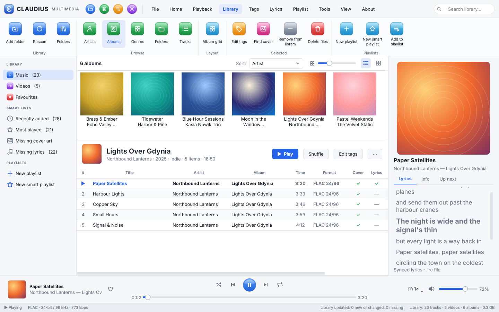

| Video with subtitles (dark theme) | Tag editor |
|---|---|
| 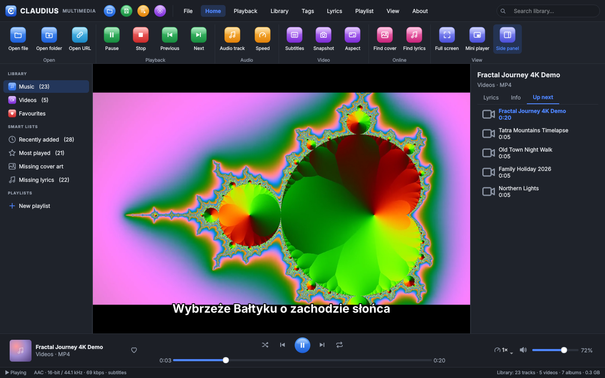 | 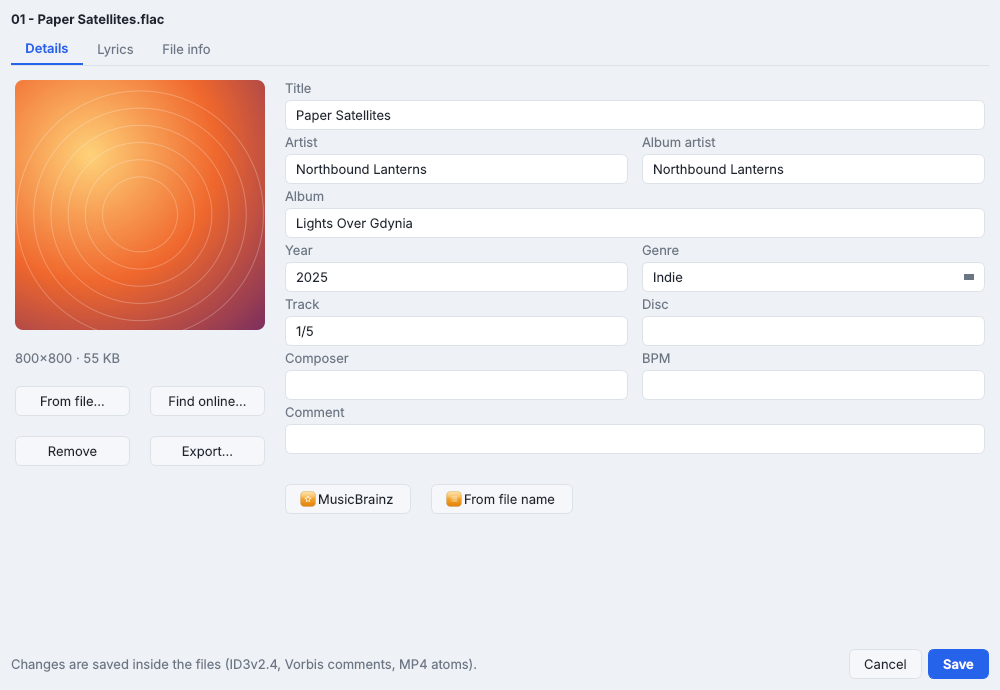 |
| **About tab** | **Polish, dark theme** |
| 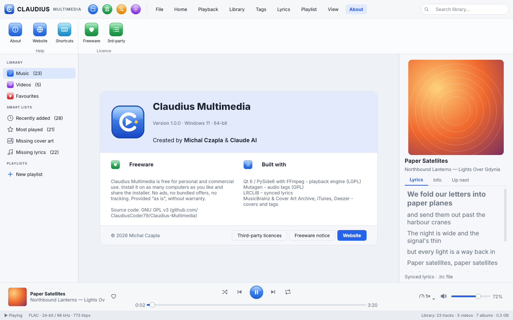 | 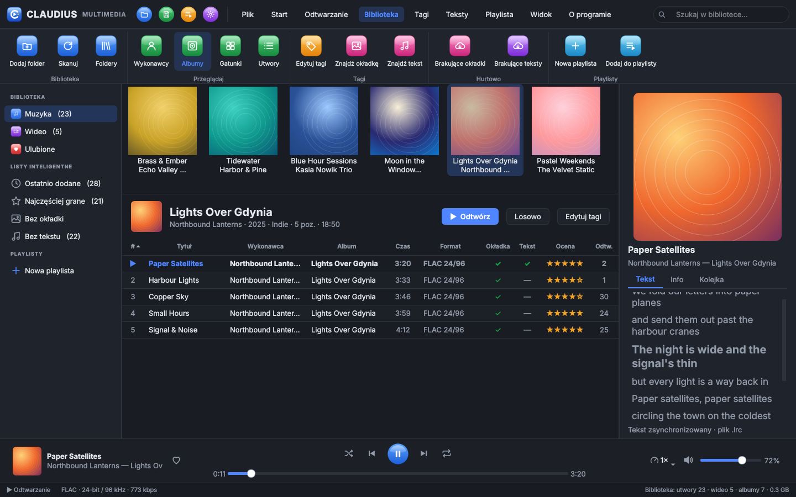 |

### New in 1.1 - library tools

| Album grid (size slider, sort) | Video library with thumbnails and "watched so far" bars |
|---|---|
| 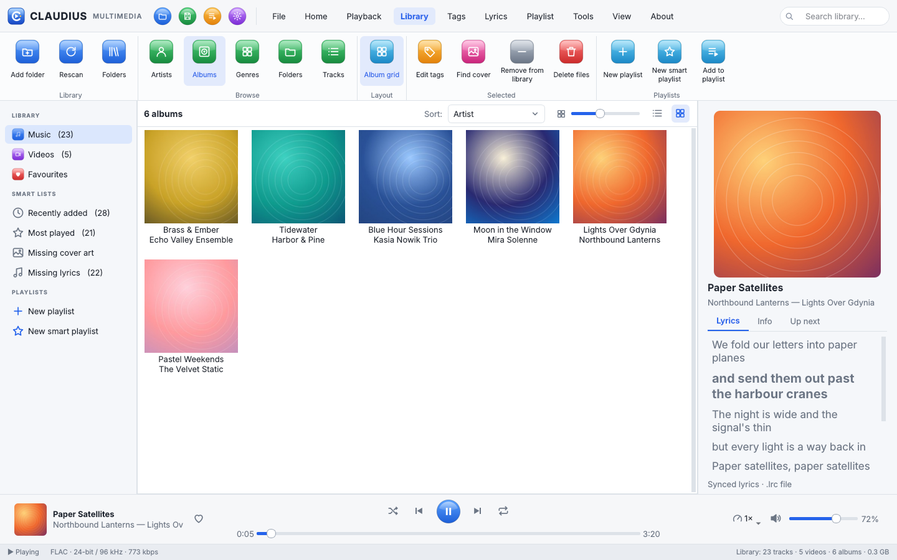 | 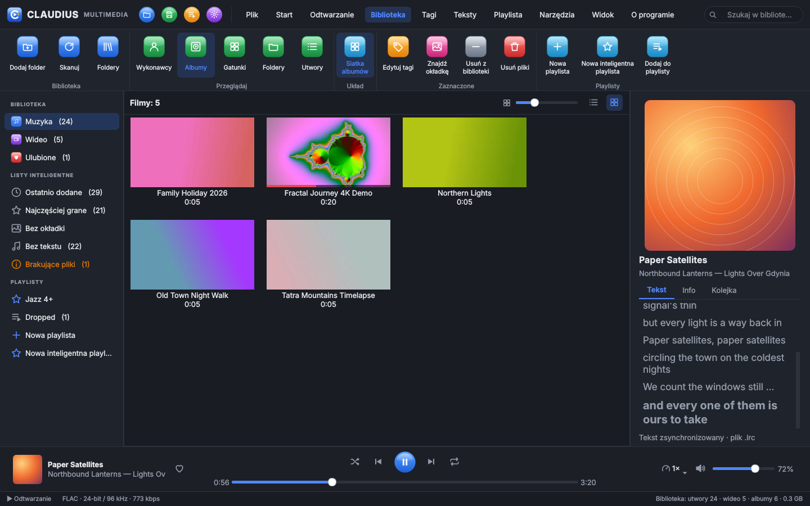 |
| **Duplicate finder** | **Smart playlist rules** |
| 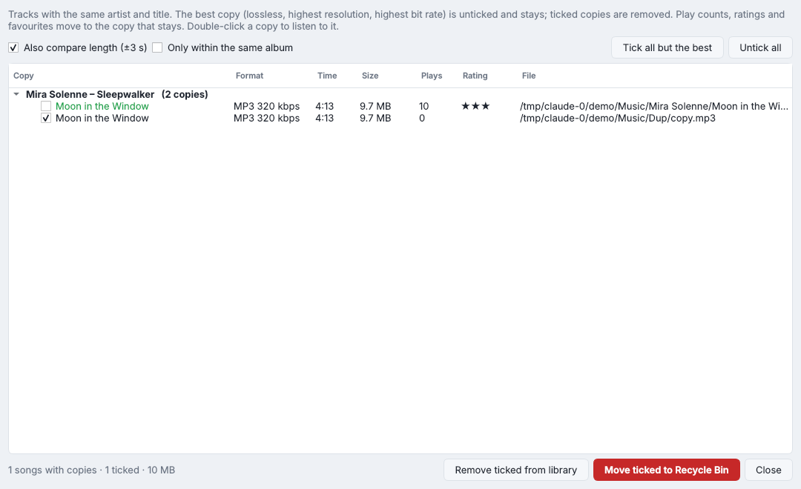 | 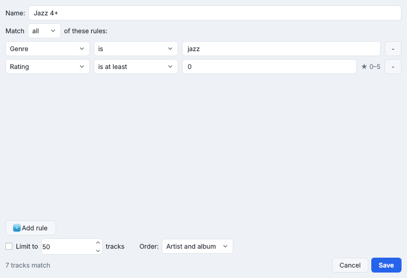 |
| **Statistics** | **Missing files (moved in Explorer) with Locate…** |
| 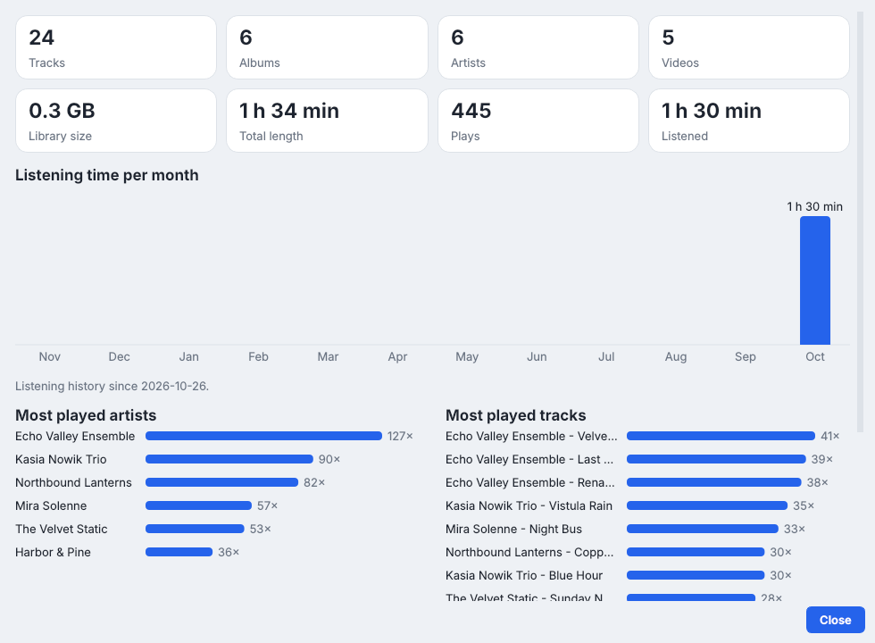 | 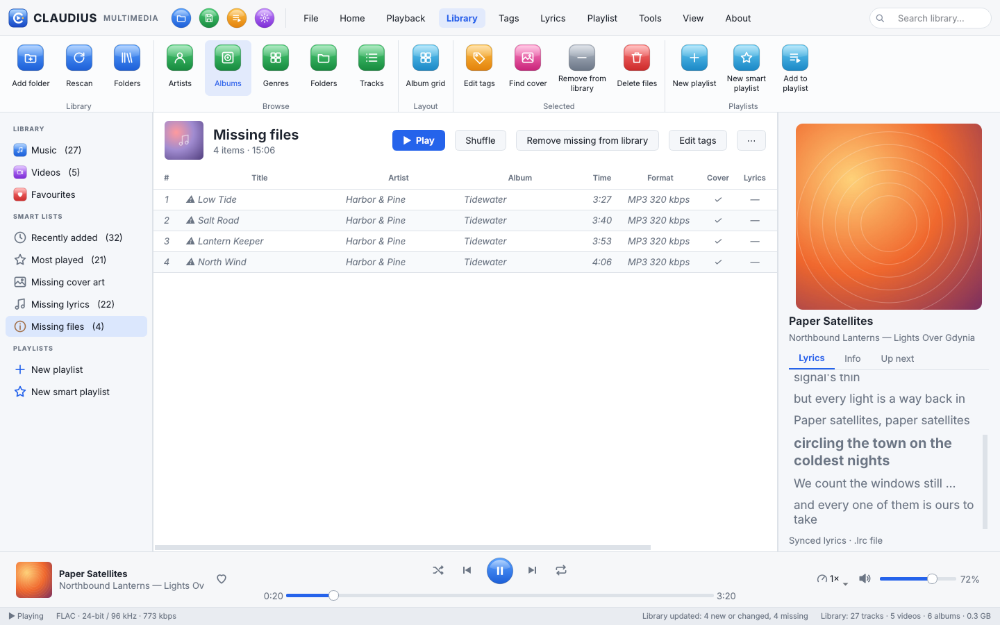 |
| **Folder view** | **Hidden items (removed from the library, files untouched)** |
| 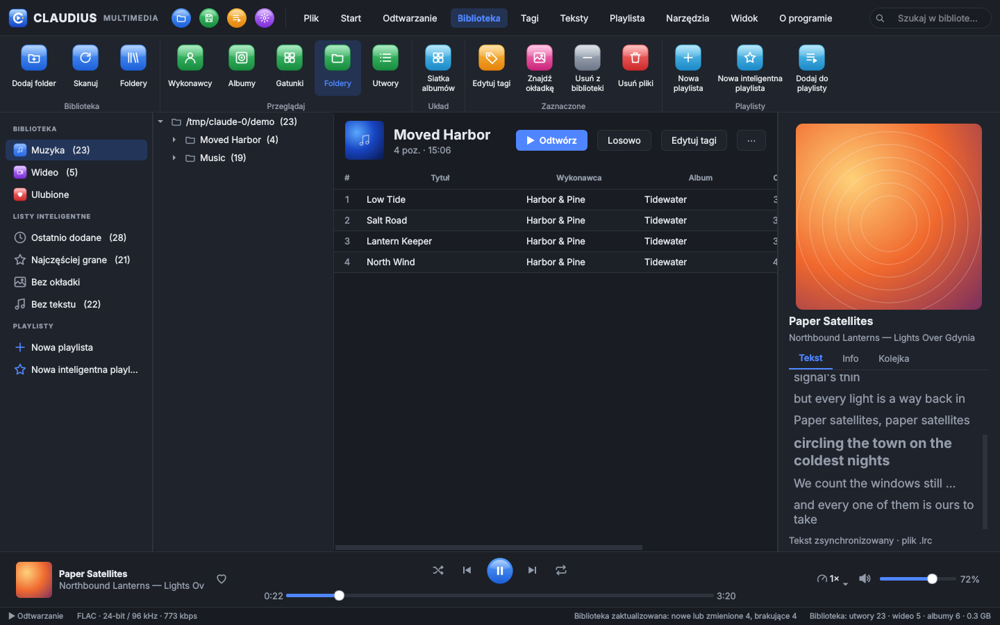 | 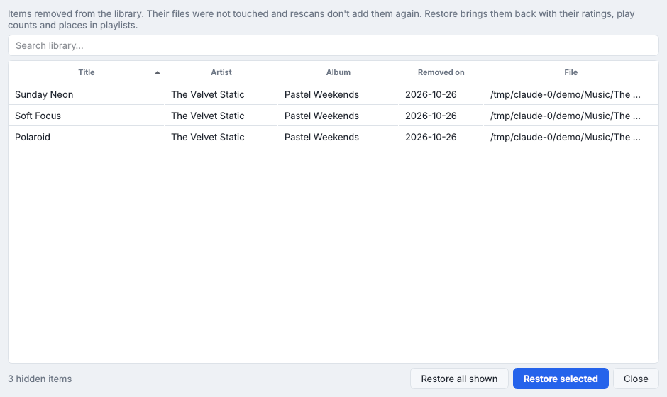 |

## Download the installer (built by GitHub)

1. Open the **Actions** tab -> latest green run of "Build Claudius Multimedia for Windows" -> **Artifacts**
   -> download `Claudius-Multimedia-installer` (Claudius-Multimedia-Setup-1.1.1.exe) or
   `Claudius-Multimedia-windows-x64` (portable zip: unzip anywhere, start `Claudius Multimedia.exe`).
2. Or, for a public download page: create a tag `v1.1.1` (see below); the installer then appears under **Releases**.

The installer puts the program in `C:\Program Files (x86)\Claudius Multimedia`, creates the Start Menu folder
**Claudius Multimedia** (program, Uninstall, Freeware notice, Read me), an optional desktop icon and optional
file associations, and registers the uninstaller in Windows Settings › Apps.

## Features

| | |
|---|---|
| **Playback** | Audio: MP3, FLAC (hi-res), M4A/AAC/ALAC, OGG, Opus, WAV, WMA, AIFF, APE, WavPack… Video: MP4, MKV, AVI, MOV, WMV, WebM, MPG, TS, FLV… Internet streams (http/https/rtsp). Play queue, shuffle, repeat all / one, speed 0.25–4×, snapshot (F12), aspect ratio, audio-track choice |
| **Subtitles** | SRT / WebVTT loaded automatically when they sit next to the video (`movie.srt`, `movie.pl.srt`), or by hand; embedded subtitle tracks |
| **Library** | Your music & video folders in a fast SQLite library. Albums as a strip above the tracks or as a full grid (tile size slider, Ctrl + wheel), sorted by artist, title, year, date added or plays. Browse by artist, album, genre, **folder tree** or track. Albums with the same name by different artists stay apart. Search, ratings, favourites, play counts, playlists, M3U/M3U8/PLS import & export |
| **Right-click everywhere** | On albums, videos, artists, genres, folders and tracks: play, play next, add to queue / playlist, edit tags, find cover / lyrics, rate, favourite, show in folder, **Remove from library** (Del) and **Delete files** (Shift+Del, to the Recycle Bin) |
| **Keeping it tidy** | Removed items stay out after rescans; **Tools › Hidden items** brings them back with ratings and play counts. **Missing files** (moved or deleted in Explorer) are greyed out - *Locate…* finds one and the others that moved with it. **Duplicate finder** keeps the best copy and moves play counts and ratings to it. **Watch folders** adds new files by itself. **Back up / Restore** the whole library (ratings, play counts, playlists, history, settings) as one file |
| **Track list** | Choose columns (year, genre, album artist, bit rate, date added, last played, file…), drag to reorder, widths remembered. Click the stars to rate, F2 to rename a title / artist / album in place, drag tracks onto a playlist, Favourites or the "Up next" list |
| **Smart playlists** | Your own rules (e.g. *genre is Jazz and rating is at least 4*, *added in the last 30 days*, *not played in the last 180 days*), match all / any, limit and order; they update themselves |
| **Video library** | Thumbnail grid, and videos (and recordings over 20 min) **continue where you stopped** - press Home to start over |
| **Statistics** | Library totals, listening time per month, most played artists, tracks, albums and genres |
| **Tags** | Tag editor for one file or many at once (only changed fields are written) - ID3v2.4, Vorbis comments, MP4 atoms, APEv2. MusicBrainz look-up, tags from file name, rename files from tags |
| **Album covers** | Search iTunes, Deezer and MusicBrainz / Cover Art Archive, pick one, embed it - or fetch missing covers for the whole library in one go |
| **Lyrics** | Synced (karaoke-style, click a line to jump there) and plain lyrics from LRCLIB; saved as `.lrc` next to the track and/or inside the file; timing adjust; batch download |
| **Look** | Ribbon like the reference design, glossy icons, System / Light / Dark theme (follows Windows live), 6 accent colours, mini player, full screen, always on top |
| **Languages** | EN, PL, DE, FR, IT, ES - translation files in `lang\*.json`, editable |
| **Windows** | Splash screen while starting, single instance (double-click a file in Explorer and it plays in the open window), media keys while the window is active, drag & drop, "Play with Claudius Multimedia" on folders |

Online look-ups send only artist, album, title and length, and can be switched off in **Settings › Online**.

## How to build from scratch on GitHub

1. Create a new repository on github.com (e.g. `Claudius-Multimedia`).
2. Upload **all** files of this folder, keeping the structure (including the `lang` folder and the hidden folder `.github/workflows/`).
   Easiest: `git clone`, copy the files in, then `git add . && git commit -m "Claudius Multimedia 1.1.0" && git push`.
3. Push to `main` -> the build starts automatically (Actions tab, about 10 minutes). Also use *Run workflow* to start it by hand.
   The build also starts the finished program once (`--selftest`) to check that it opens and plays a test tone.
4. Release: `git tag v1.1.1 && git push origin v1.1.1` -> the workflow also creates a GitHub Release with
   `Claudius-Multimedia-Setup-1.1.1.exe`, `Claudius-Multimedia-portable-1.1.1.zip` and `SHA256SUMS.txt`.

## Build on your own PC

* Run from source: install Python 3.12 (64-bit), then `python -m pip install -r requirements.txt` and `python claudius_multimedia.py` (or `run.bat`).
* EXE: `build_exe.bat` -> `dist\Claudius Multimedia\Claudius Multimedia.exe` (a folder; keep it together).
* Installer: `build_installer.bat` (needs the free Inno Setup 6) -> `installer\Claudius-Multimedia-Setup-1.1.1.exe`.

## Keyboard shortcuts

`Space` play/pause · `←/→` seek 5 s · `Ctrl+←/→` 30 s · `↑/↓` volume · `M` mute · `N`/`P` next/previous · `S` stop ·
`[`/`]` speed · `F11`/`Enter` full screen · `Esc` leave full screen / mini player · `Ctrl+M` mini player ·
`Ctrl+O` open · `Ctrl+U` open URL · `Ctrl+T` tag editor · `Ctrl+L` lyrics · `Ctrl+F` search · `F5` rescan library · `F12` snapshot ·
`Home` start the video from the beginning · in the library: `Del` remove from library · `Shift+Del` delete files (Recycle Bin) · `F2` rename · `Ctrl` + mouse wheel tile size

## Files

| File | Purpose |
|---|---|
| `claudius_multimedia.py` | start-up: splash screen, single instance, self-test |
| `cm_main.py` | main window (ribbon tabs, library, now playing, About tab) |
| `cm_widgets.py`, `cm_dialogs.py` | ribbon, transport bar, video view, lyrics view, track table, album / video tiles, folder tree; tag editor, cover / lyrics / MusicBrainz search, settings, hidden items, statistics |
| `cm_smart.py`, `cm_duplicates.py` | smart playlist rule editor; duplicate finder |
| `cm_player.py` | playback engine, play queue, resume positions, video thumbnails (Qt Multimedia + FFmpeg) |
| `cm_library.py`, `cm_tags.py`, `cm_online.py`, `cm_parse.py` | library database, tags, online services, LRC / SRT / M3U parsing |
| `cm_core.py`, `cm_theme.py`, `cm_icons.py` | version, settings, translations; themes; glossy icons and logo |
| `lang\*.json` | translations (en, pl, de, fr, it, es) |
| `claudius.ico`, `splash.png`, `version_info.txt` | program icon, splash screen, Windows version info |
| `FREEWARE.txt`, `LICENSE` | freeware notice shown by the installer; the licence (GNU GPL v3) |
| `build_exe.bat`, `build_installer.bat`, `installer.iss`, `run.bat` | local builds and start from source |
| `.github/workflows/build.yml` | automatic build on GitHub |
| `tools/check_translations.py` | checks that every language has every text |
| `docs/` | screenshots of the program and the original design mock-ups |

If something goes wrong, the program writes the details to `%APPDATA%\Claudius Multimedia\claudius.log`.
Settings, library database and cover / thumbnail cache are stored in `%APPDATA%\Claudius Multimedia`.
A 1.0 library is upgraded automatically the first time 1.1 starts.
